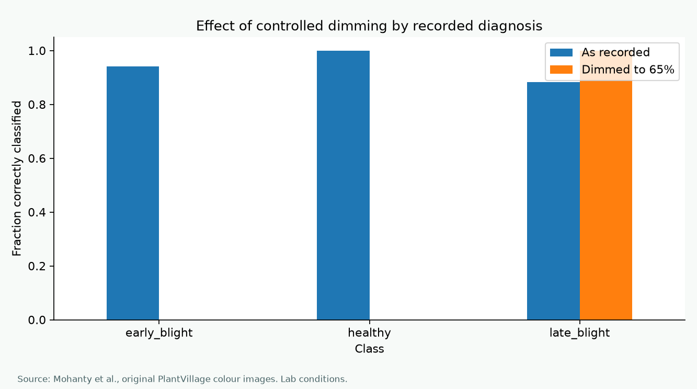
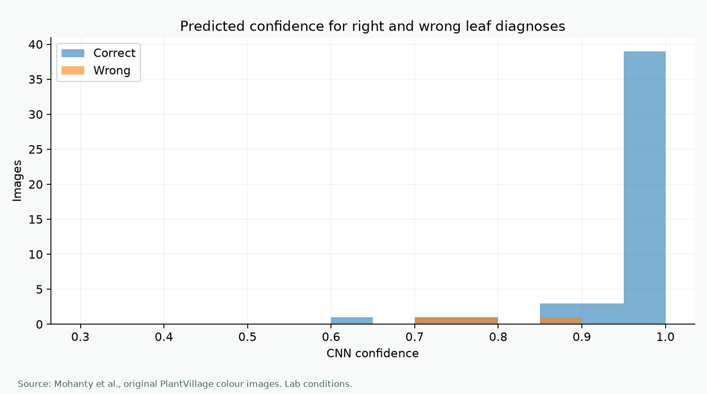
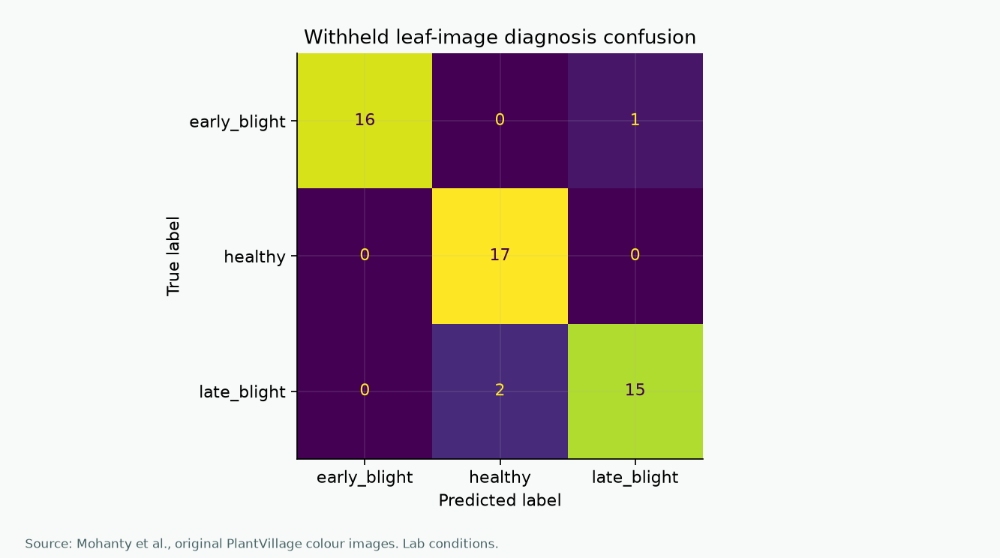
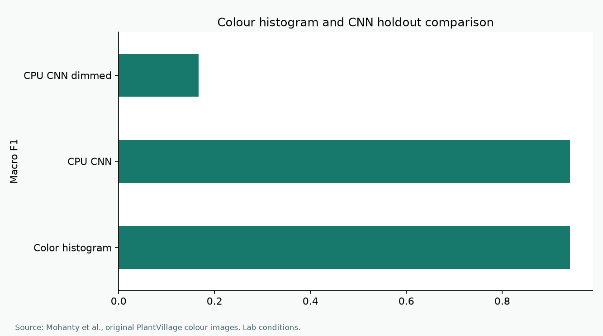
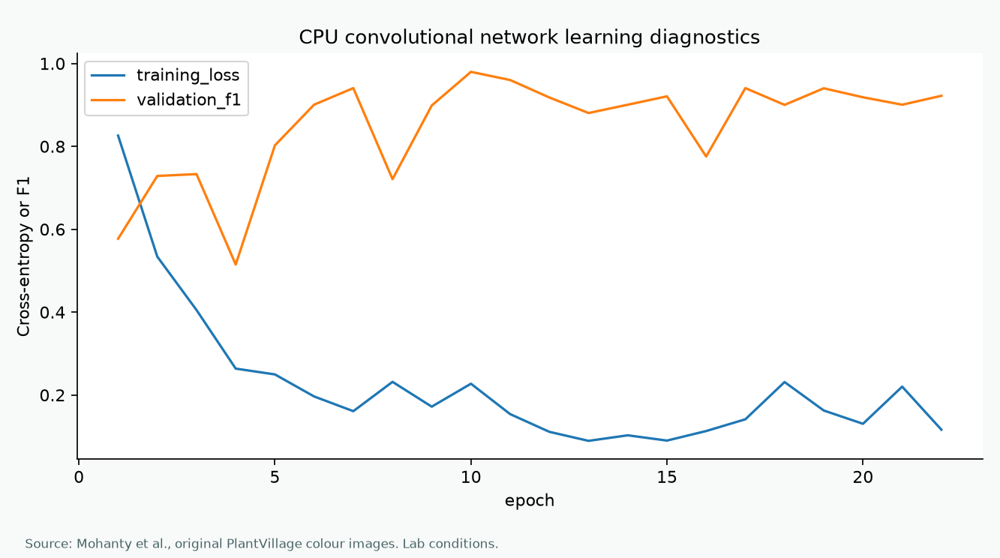
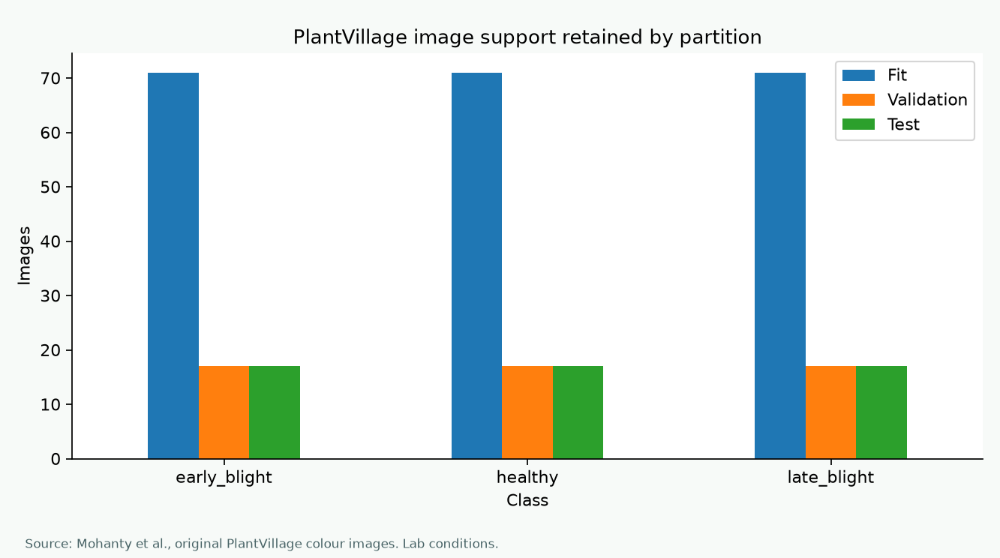
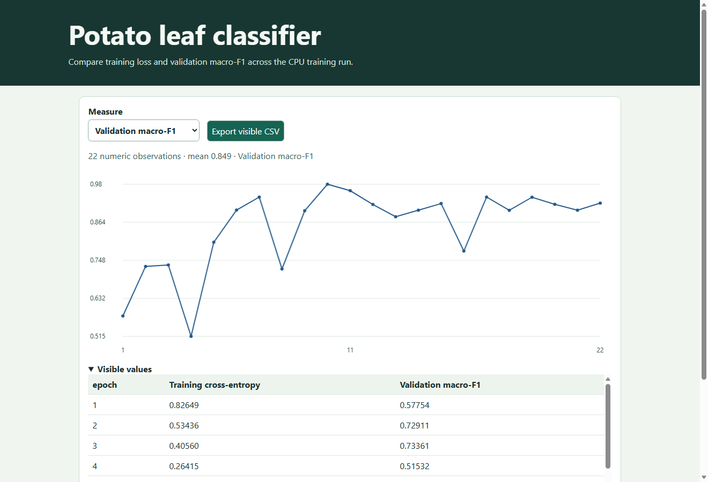

# Plant Disease Detection with Deep Learning

## Project overview

Benchmark a compact CPU image classifier against a color-only baseline for potato leaf triage.

## Business problem and objectives

A screening workflow needs to know when the camera and lighting matter more than model capacity. The evaluation defines a simple reference, a fixed protocol and output a reader can inspect and reproduce.

## Dataset

315 PlantVillage photographs across early blight, healthy and late blight. The pinned subset has 105 images per class.

## Data source and license

The author dataset card declares CC BY-SA 3.0. The original GitHub image snapshot has no separate license file. Images and trained weights are excluded. The published outputs are aggregate benchmark diagnostics.

- [Original release by Mohanty, Hughes and Salathé](https://github.com/spMohanty/PlantVillage-Dataset)
- [Author dataset card](https://huggingface.co/datasets/mohanty/PlantVillage)
- [Original study](https://doi.org/10.3389/fpls.2016.01419)

## Architecture and technologies

Verified data snapshot → prepared observations → baseline and evaluation → aggregate outputs → offline interactive dashboard.

Python, PyTorch, Deep Learning, Computer vision, scikit-learn, Jupyter, JavaScript. The input URLs and content hashes are in [the source manifest](data/source-manifest.json). The [analysis notebook](notebooks/analysis.ipynb) independently reopens the verified inputs and displays the measured results.

## Exploratory analysis, models and evaluation

Resize RGB images to 64 × 64 and keep perceptual neighbors in the same partition. Compare a color-histogram logistic baseline and a small PyTorch CNN. Select the CNN checkpoint on validation macro-F1, then evaluate both methods on 51 held-out photos. Darken the identical test set to quantify sensitivity to a controlled lighting change.

## Results

Both methods scored 0.941 macro-F1. The CNN scored 0.167 after dimming, with accuracy falling to 0.333. The class-level confusion and confidence plots show the clean-image errors behind the headline.

Detailed values are stored in [metrics.json](reports/metrics.json).

## Visualizations













## Installation and reproducibility

Use Python 3.13 in a virtual environment and run the following commands from the project root. The first run downloads the pinned data over HTTPS and verifies SHA-256. Subsequent runs reuse verified files from `data/raw/`.

```powershell
python -m venv .venv
. .venv/Scripts/Activate.ps1
python -m pip install -r requirements.txt
python -m pip install torch==2.9.1 --index-url https://download.pytorch.org/whl/cpu
python study.py
python -m pytest -q
python project_dashboard.py
python -c "import nbformat; from nbclient import NotebookClient; NotebookClient(nbformat.read('notebooks/analysis.ipynb', as_version=4), kernel_name='python3', timeout=180).execute()"
```

## Application demo

Open [the dashboard](dashboard.html) in a browser. Use the metric and available group controls to inspect evaluation results, expand the table for individual aggregates and download the selection as CSV.



## Limitations

The balanced test is small and contains controlled scenes. Perceptual hashes capture only some related photographs. The benchmark has no verified field calibration or operational diagnostic threshold.

## Future improvements

Evaluate prospectively collected field images with group identifiers for site, leaf, camera and acquisition date.
